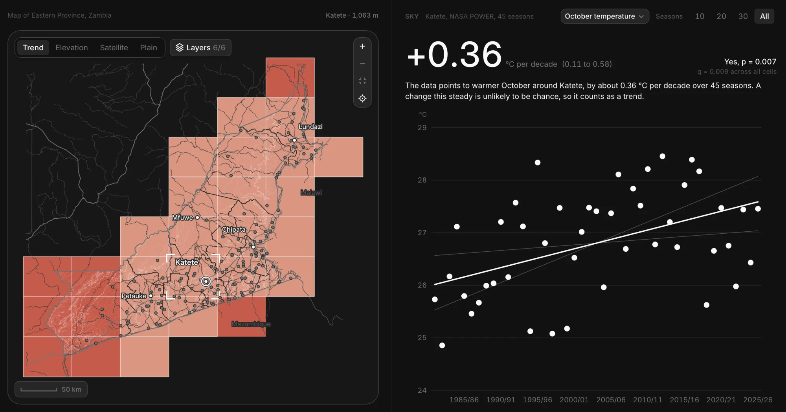
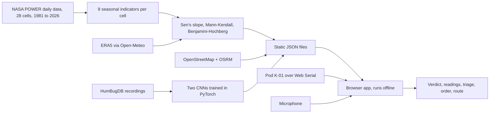
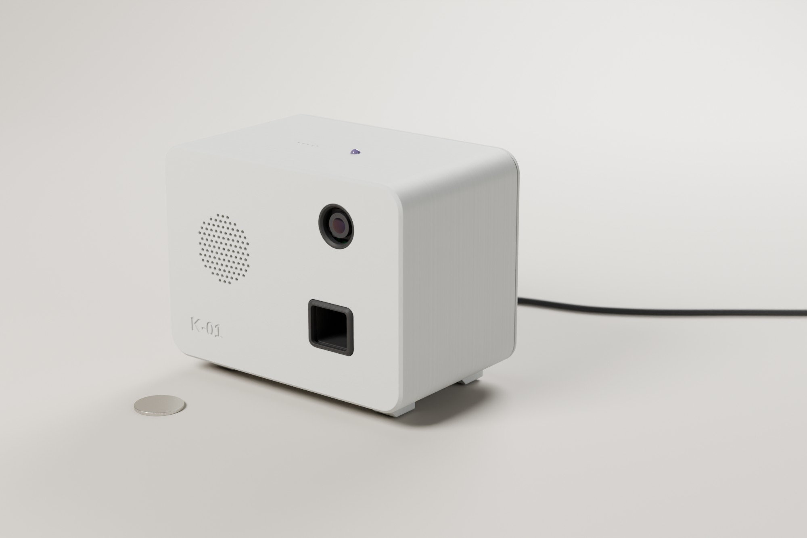

<p align="center">
  
</p>

<h1 align="center">Project Astrophage</h1>

<p align="center"><b>Is the rainy season in eastern Zambia changing, and what should a health team do about it?</b></p>

<p align="center">
  <a href="assets/demo.mp4"></a>
  
  
  <a href="LICENSE"></a>
</p>

<p align="center">
  
  
  
  
  
  
  
</p>

> **Try it in two minutes:** `npm ci && npm run build && npm start`, then open **http://localhost:3000/mission/?story=1&sim=1** and press the right arrow key to walk through the demo. No internet, accounts or API keys needed.

## What it does

Everything lives on one page, `/mission/`, and follows one loop: **Detect, Verify, Act.**

| Part | What you get |
|---|---|
| **SKY (Detect)** | Pick any town or health facility in Eastern Province. The app finds its NASA POWER grid cell and tests 9 seasonal indicators over 45 seasons, with Sen's slope, a 95% range and a Mann-Kendall p-value, in a four-line plain-English verdict. |
| **The map** | Every cell coloured by its trend, and outlined only if it survives a Benjamini-Hochberg correction across all 28 cells. Switch between trend, elevation, NASA GIBS satellite imagery and a plain map, with roads, rivers, districts and 144 health facilities. |
| **Record switch** | Rerun any test on the last 10, 20 or 30 seasons to see how a short record can point the wrong way. |
| **GROUND (Verify)** | Live pulse, SpO2, air temperature and humidity from pod K-01 over USB. Every reading sits next to its tested error, or says "not yet tested" when it hasn't been checked yet. |
| **Mosquito ears** | Two small neural networks listen through the microphone, right in the browser, and say whether there's a mosquito and which of 8 species it is. |
| **ACTION (Act)** | A short danger-sign check turns a patient's answer into a triage outcome, a medicine order and a delivery from Chipata along a real road route. |
| **How we know** | The methods, the limits, every data source and a list of published research on each change. |

---

## How it works



The heavy lifting happens once, ahead of time. Python scripts pull NASA POWER data for every grid cell, run the trend tests, cross-check them against ERA5, build the road routes offline with OSRM and train the mosquito models. Everything lands as plain JSON in `public/`.

On the day, the app is just a static site. It runs with Wi-Fi off and makes no AI or API calls. The one optional exception is the NASA GIBS satellite picture, which only loads if you pick that map style.

### The mosquito model

Every half second the app takes the newest 2.1 seconds of 8 kHz audio and turns it into a 128 by 30 log-mel picture of the sound. That goes through a small convolutional network: four 3×3 conv blocks (16, 32, 64, 64 channels) with batch norm, ReLU and max-pooling, then a global average and one dense layer. There are two copies, about 60,000 weights each. One answers "mosquito or not", the other names the species. Both run in plain TypeScript with no ML library.

We trained on [HumBugDB](https://doi.org/10.5281/zenodo.4904800), split by recording so no test sound was ever seen in training. Because we demo by playing recordings from a phone, most training windows go through a simulated phone speaker, room echo and background noise, and read speech is added as examples of what isn't a mosquito.

### Why we trust the numbers

- **We correct for testing many cells at once.** With 28 cells, a few "significant" trends would show up by chance. The map only outlines cells that survive a Benjamini-Hochberg correction.
- **We check against a second source.** Rain and temperature trends are re-run on ERA5 for all 28 cells.
- **We say what isn't tested.** Until a sensor has been compared with a reference, the screen says "not yet tested" instead of showing a made-up accuracy.

---

## Results

| Finding (NASA POWER, 1981/82 to 2025/26) | Cells with a significant trend after correction |
|---|---|
| October is getting hotter, +0.23 to +0.45 °C per decade | **27 of 28** |
| The wettest day of the season is getting heavier | **13 of 28** |
| Fewer rainy days | **5 of 28** |
| Total wet-season rainfall | **0 of 28** (no trend) |

| Mosquito model (held-out recordings) | Value |
|---|---|
| Detector ROC AUC | **0.988** |
| Mosquitoes found / false alarms | **95% / 4%** (93% / 5% through a simulated phone speaker and room) |
| Read speech flagged as a mosquito | under 1% |
| Species, 8 classes, balanced per recording | **53%** (chance is 12.5%) |

---

## The pod

Pod K-01 is a 3D-printable box, 150 × 98.5 × 120 mm, built around a Seeed XIAO nRF52840. A MAX30101 sensor in the finger port reads pulse and SpO2, and an SHT31-D on a short lead reads the air outside the box. Everything comes in over one USB-C cable as one JSON line per reading. The enclosure has room for a camera, speaker and UV LED that the software doesn't use yet.

<p align="center">
  
  <br/>
  <em>A render of the CAD design. It prints in 9 parts with no supports, about 11 hours and 247 g of filament.</em>
</p>

---

## Tech stack

- **Web app:** Next.js 15 (static export), React 19, TypeScript, Tailwind CSS 4, BoardUI components, d3-geo for the map, zustand for state
- **Data and stats:** Python, NumPy, SciPy (Sen's slope, Mann-Kendall, Benjamini-Hochberg), NASA POWER, ERA5 through Open-Meteo, SerpApi for the research list
- **Maps:** OpenStreetMap, OSRM, osmium, GDAL, geoBoundaries, Natural Earth, Copernicus DEM, NASA GIBS
- **Machine learning:** PyTorch and librosa for training, plain TypeScript for inference in the browser
- **Hardware:** Arduino firmware for the XIAO nRF52840, build123d for the parametric CAD, Blender for the renders
- **Testing:** Vitest, Playwright and pytest

---

## Run it locally

You need **Node 22** and **Python 3.10+**. Run everything from the repo root.

### The web app
```bash
npm ci
npm run build      # writes the static site to out/
npm start          # serves http://localhost:3000
```

Open **http://localhost:3000/mission/**. For development with hot reload, use `npm run dev` instead.

| Try this | What happens |
|---|---|
| `/mission/?story=1&sim=1` | The guided demo. Right and left arrows step through it, with a simulated pod. |
| `/mission/?place=katete` | Opens on a specific place (ids are in `trend/places.json`). |
| `/mission/?record=1` | Records pod events and adds a "Download session" button. |
| Press `R` | Replays `public/pod/replay.json`, if you've recorded one. |
| `/sounds/` on a phone | Plays a held-out recording of each mosquito species. Hold it near the laptop and press "Listen for mosquitoes" in GROUND. |

The laptop has to use `localhost` for the microphone to work. A phone on the same Wi-Fi can open `http://<laptop address>:3000/sounds/`.

### Tests
```bash
npm test                         # unit tests (Vitest)
npm run lint && npm run typecheck
npx playwright install chromium
npm run e2e                      # browser tests; run npm run build first

python3 -m venv .venv && . .venv/bin/activate
pip install -r trend/requirements.txt -r validation/requirements.txt
python -m pytest trend validation -q
```

### Connect the real pod

Flash `firmware/pod_k01` (see [`firmware/README.md`](firmware/README.md)), plug the pod in, open the app in **Chrome or Edge** and press **Connect pod** in GROUND. Web Serial only works there, and only on `localhost` or HTTPS. If no reading arrives for 5 seconds, the panel says "pod offline".

### Rebuild the data

You don't need to do this to run the app; the built files are already in `public/`.

```bash
python trend/build_trends.py --places trend/places.json --out public/trends   # NASA POWER trends
python trend/cross_check.py --trends public/trends                            # ERA5 cross-check
SERPAPI_API_KEY=your_key python trend/evidence.py                             # optional research list
```

Downloads are cached in `trend/cache/`, so a second run doesn't hit the APIs again. Run `build_trends.py` before `cross_check.py`, since the build rewrites the cell files. If Python hits a certificate error on macOS, `pip install certifi` and put `SSL_CERT_FILE=$(python -m certifi)` in front of the command.

<details>
<summary><b>More: venue normals, validation, map rebuild, CAD</b></summary>

**Normals for the venue.** GROUND compares the live air reading with NASA POWER's normal range for today at the pod's location. It's built for Austin, Texas. For somewhere else:
```bash
python trend/normals.py --lat 30.2672 --lon -97.7431 --name "Austin, Texas" --out public/trends/pod_site.json
```

**Validation.** Put real paired readings into `validation/pulse/readings.csv`, `validation/mosquito/trials.csv` and `validation/weather/log.csv`, then run `python validation/report.py` and `npm run build`. The GROUND panel then shows each sensor's tested error.

**Recording a replay.** Open `/mission/?record=1`, connect the pod, take some readings, press "Download session", save it as `public/pod/replay.json` and rebuild.

**Map data.** `bash mapdata/build.sh` downloads about 700 MB and rewrites `public/map/` and `trend/places.json`. It needs GDAL, osmium-tool, Docker (for OSRM) and `pip install shapely pyproj openpyxl`. See [`mapdata/README.md`](mapdata/README.md), and rerun the trend build afterwards.

**Mosquito models.** See the header of `models/mosquito/train.py`.

**The enclosure.** [`hardware/cad/README.md`](hardware/cad/README.md) rebuilds the CAD and print files; [`hardware/render/README.md`](hardware/render/README.md) covers the Blender renders.

</details>

---

## Project structure

```
NASASpaceApps/
├── app/                  # Next.js pages: /mission/ (the app) and /sounds/ (phone page)
├── components/
│   ├── mission/          # SKY, GROUND, ACTION, the map, story mode
│   ├── sounds/           # the phone sound board
│   └── base/ ...         # BoardUI components
├── lib/
│   ├── trends/           # loading and formatting the trend files
│   ├── pod/              # Web Serial, the simulator, the mosquito listener and model
│   ├── mission/          # triage, orders, delivery, story steps
│   └── map/              # projection, layers, labels, NASA GIBS
├── public/               # the built data: trends, map, model weights, clips
├── trend/                # trend engine, NASA POWER build, ERA5 cross-check, SerpApi evidence
├── models/mosquito/      # training and test scripts for the two CNNs
├── mapdata/              # scripts that build the map and the road routes
├── validation/           # CSVs for pod vs reference readings, and the report
├── firmware/             # pod K-01 (XIAO) and the early Uno robot-car prototype
├── hardware/             # parametric CAD, print files, renders
├── assets/               # the README banner and the demo video
└── e2e/                  # Playwright browser tests
```

## Credits and licences

The code is under the [MIT License](LICENSE). The data keeps its own licences:

NASA POWER data comes from the NASA Langley Research Center POWER project, with values from the MERRA-2 reanalysis (NASA GMAO). The cross-check uses the ECMWF ERA5 reanalysis through the Open-Meteo archive API. Mosquito recordings are from HumBugDB (Kiskin et al. 2021, CC BY 4.0). Map and facility data:

The data was obtained from National Aeronautics and Space Administration (NASA) Langley Research Center's Prediction Of Worldwide Energy Resources (POWER) project funded through the NASA Earth Science Division. We acknowledge the use of imagery provided by services from NASA's Global Imagery Browse Services (GIBS), part of NASA's Earth Science Data and Information System (ESDIS).

| Data | Licence | Used for |
|---|---|---|
| [geoBoundaries Zambia ADM1 (Zambia Data Hub)](https://github.com/wmgeolab/geoBoundaries/raw/9469f09/releaseData/gbOpen/ZMB/ADM1/geoBoundaries-ZMB-ADM1.geojson) | Creative Commons Attribution 4.0 International (CC BY 4.0) | province outline |
| [geoBoundaries Zambia ADM2 (GRID3, Office of the Surveyor General)](https://github.com/wmgeolab/geoBoundaries/raw/9469f09/releaseData/gbOpen/ZMB/ADM2/geoBoundaries-ZMB-ADM2.geojson) | Creative Commons Attribution 4.0 (CC BY 4.0) | district outlines and facility districts |
| [Natural Earth 1:10m admin 0 boundary lines](https://naciscdn.org/naturalearth/10m/cultural/ne_10m_admin_0_boundary_lines_land.zip) | Public domain (Natural Earth terms of use) | international borders |
| [Natural Earth 1:10m admin 0 countries](https://naciscdn.org/naturalearth/10m/cultural/ne_10m_admin_0_countries.zip) | Public domain (Natural Earth terms of use) | country names and label points |
| [Public health facilities in sub Saharan Africa (Maina et al. 2019, Scientific Data, doi:10.1038/s41597-019-0142-2)](https://doi.org/10.6084/m9.figshare.7725374.v1) | CC0 (https://creativecommons.org/publicdomain/zero/1.0/) | health facility names, types and locations |
| [OpenStreetMap Zambia extract (Geofabrik)](https://download.geofabrik.de/africa/zambia-latest.osm.pbf) | Open Database License 1.0 (ODbL), (c) OpenStreetMap contributors | roads, rivers, towns and road routing (OSRM) |
| [Copernicus DEM GLO-90 (AWS Open Data, copernicus-dem-90m)](https://copernicus-dem-90m.s3.amazonaws.com) | Copernicus DEM GLO-90, free licence; produced using Copernicus WorldDEM-90 (c) DLR e.V. 2010-2014 and (c) Airbus Defence and Space GmbH 2014-2018 provided under COPERNICUS by the European Union and ESA; all rights reserved | hillshade relief (49 tiles) |

---

<p align="center">
  <sub>Built for <b>RiverHacks × NASA Space Apps 2026</b> by the Project Astrophage team</sub>
</p>
